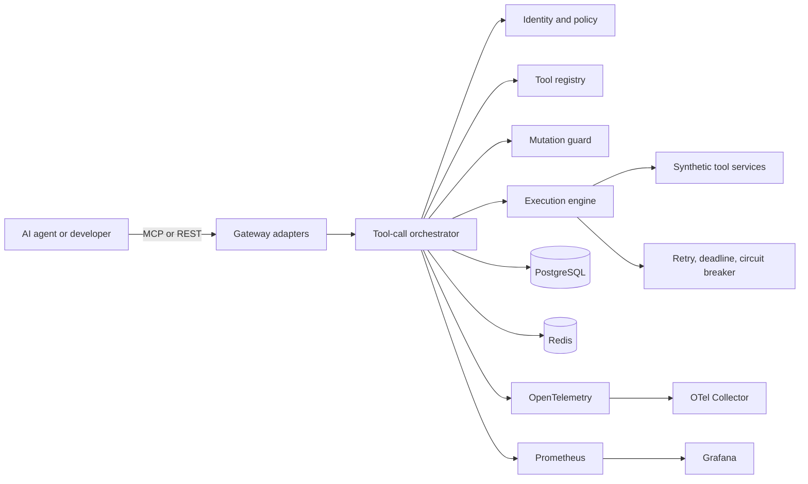

# SentinelMCP

**A reliability, safety, and observability control plane for AI agent tool calls.**

SentinelMCP is an open-source infrastructure project for mediating calls from AI agents to
external tools. It is designed to make tool execution explicit, policy-controlled,
observable, replayable, and resilient to dependency failures.

> **Project status:** Phases 1 and 2 are complete. Architecture boundaries and an immutable,
> versioned in-memory tool registry are implemented with Draft 2020-12 schema validation. The
> runtime gateway, network execution, and durable persistence are not implemented yet.

## Why this exists

Agent frameworks make it easy to invoke a function. Production systems must answer harder
questions: Who authorized the call? Was it a read or a mutation? Can it be retried? Did the
upstream return valid data? How do we prevent a stale confirmation from changing different
arguments? What failed, and can the request be reproduced safely?

SentinelMCP provides one execution path where those concerns can be enforced consistently.
It does not decide what an agent should think. It controls what an agent is allowed to do.

## Target architecture



The gateway begins as a **modular monolith**. Protocol adapters share one application
orchestrator, while registry, policy, mutation safety, execution, audit, and telemetry remain
separate modules with explicit ownership. This avoids distributed transactions inside the
control plane before scale requires service extraction.

See [Architecture](docs/ARCHITECTURE.md) and
[Design decisions](docs/DESIGN_DECISIONS.md) for the detailed request lifecycle and tradeoffs.

## Implemented capabilities

- Typed namespaces, names, exact SemVer versions, identities, and tool references
- Deeply immutable tool definitions with read or mutation operation classes
- RFC 8785 canonical definition bytes and deterministic SHA-256 fingerprints
- Draft 2020-12 input/output schema checks with bounded complexity and no remote references
- Structured runtime argument and output validation errors
- Persistence-independent registry protocol and thread-safe in-memory implementation
- Exact lookup, deterministic listing, SemVer ordering, and latest-version resolution
- Idempotent identical registration and immutable conflict rejection

The full behavioral contract and current limits are in
[Tool registry and schemas](docs/TOOL_REGISTRY.md).

## Planned capabilities

- MCP-compatible and REST entry points with a shared execution contract
- Authentication, RBAC, operation classification, and policy decisions
- Preview and single-use confirmation for sensitive mutations
- Idempotency records for mutation retry safety
- Deadline propagation, bounded retries, and three-state circuit breakers
- Structured upstream response validation and normalized errors
- Redacted append-only audit events and deterministic replay against synthetic services
- OpenTelemetry traces, Prometheus metrics, and checked-in Grafana dashboards
- Fault injection, reliability evaluation, and reproducible performance benchmarks

## Repository map

```text
src/sentinelmcp/
  adapters/          MCP and REST transport boundaries
  application/       Tool-call orchestration use cases
  domain/            Transport- and storage-independent types and errors
  registry/          Tool definitions, versions, and execution policies
  policy/            Authentication context and authorization decisions
  mutation_guard/    Preview, confirmation, replay protection, idempotency
  execution/         Deadlines, retries, circuit breaking, upstream decoding
  audit/             Redaction and append-only audit events
  telemetry/         Traces, metrics, and structured logging
  replay/            Safe reconstruction against synthetic services
  evaluation/        Scenario execution and reliability attribution
  fault_injection/   Controlled failure plans for test environments
  cli/               Developer and operator commands
services/mock_tools/ Synthetic APIs used by demos and tests
tests/                Unit, architecture, API, integration, concurrency, property tests
deploy/               Local infrastructure and observability configuration
benchmarks/           Reproducible load generation and result processing
scenarios/            Deterministic demo and evaluation fixtures
```

## Development setup

SentinelMCP requires Python 3.12 or newer.

```bash
python -m venv .venv
source .venv/bin/activate  # Windows PowerShell: .venv\Scripts\Activate.ps1
python -m pip install --upgrade pip
python -m pip install -e ".[dev]"
```

Run the quality gates:

```bash
ruff format --check .
ruff check .
mypy
pytest
```

## Implementation roadmap

Work is intentionally incremental. Each phase has tests and exit criteria before the next
phase begins. The complete plan is in [Implementation plan](docs/IMPLEMENTATION_PLAN.md).

| Phase | Scope | Status |
| --- | --- | --- |
| 1 | Architecture, repository structure, quality baseline | Complete |
| 2 | Tool registry and schemas | Complete |
| 3 | Gateway and execution orchestration | Planned |
| 4 | PostgreSQL and Redis persistence | Planned |
| 5 | Authentication and authorization | Planned |
| 6 | Mutation confirmation and idempotency | Planned |
| 7 | Retries, deadlines, circuit breakers, error normalization | Planned |
| 8 | OpenTelemetry, Prometheus, Grafana | Planned |
| 9 | Synthetic tools and fault injection | Planned |
| 10 | Replay | Planned |
| 11 | Reliability evaluation | Planned |
| 12 | Performance benchmarking | Planned |
| 13 | Optional React dashboard | Deferred decision |
| 14 | Test and CI hardening | Planned |
| 15 | Documentation and release polish | Planned |

## Benchmarks

No benchmark results have been measured yet. The benchmark methodology and anti-bias rules
are defined in [Benchmarks](docs/BENCHMARKS.md). Results will be committed only with the raw
machine-readable output, environment metadata, and reproduction command.

## Security

This project is not yet ready for production use. Read the
[Threat model](docs/THREAT_MODEL.md) and [Security policy](SECURITY.md) before experimenting
with sensitive data. Synthetic services and non-secret fixtures are the only supported test
targets during development.

## License

Licensed under the Apache License 2.0. See [LICENSE](LICENSE).
