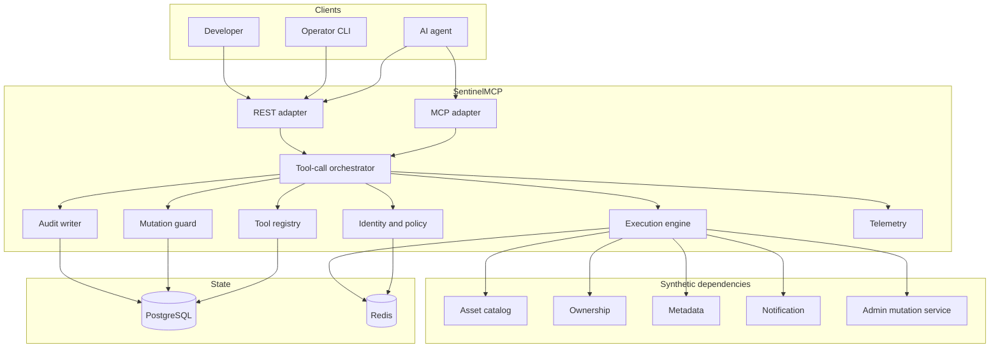
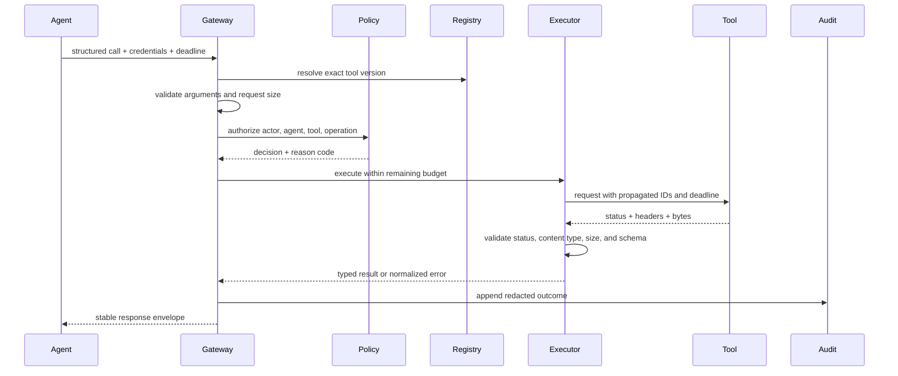

# Architecture

## 1. Purpose

SentinelMCP mediates structured tool calls between AI agents and external services. Its job is
to enforce policy and execution semantics at a boundary that agent runtimes otherwise treat as
a direct function call.

The system is both:

- a **data-plane proxy**, because every tool invocation passes through it; and
- a **control plane**, because it owns tool definitions, policies, safety controls, and
  operational evidence.

The first implementation is a modular monolith with separately deployed synthetic tool
services. The modules are designed around interfaces so that a proven bottleneck can be split
later without changing the public execution contract.

## 2. Goals and non-goals

### Goals

- One transport-independent lifecycle for REST and MCP requests.
- Explicit read-versus-mutation semantics.
- Fail-safe authorization and mutation confirmation.
- Bounded execution using deadlines, retries, and circuit breakers.
- Stable error envelopes even when an upstream response is malformed.
- Sufficient redacted evidence for audit, debugging, evaluation, and safe replay.
- Horizontal concurrency without relying on process-local correctness state.
- Reproducible reliability and performance measurements.

### Non-goals

- Choosing tools with an LLM or evaluating model reasoning inside the gateway.
- General workflow orchestration or durable multi-step agent planning.
- Claiming exactly-once effects across arbitrary external systems.
- Replaying calls against real production services.
- Storing raw secrets or unredacted arbitrary tool payloads.
- Recreating any employer-specific system, schema, or API.

## 3. System context

## 4. Module ownership

| Module | Owns | Must not own |
| --- | --- | --- |
| `adapters` | Protocol decoding, request limits, response encoding | Business policy or retries |
| `application` | End-to-end use cases and transaction boundaries | HTTP/MCP-specific types |
| `domain` | Stable IDs, operation classes, errors, decisions | Database or framework imports |
| `registry` | Versioned tool contracts and execution policy metadata | Caller authorization decisions |
| `policy` | Identity context, roles, permissions, allow/deny decisions | Tool execution |
| `mutation_guard` | Preview binding, confirmation consumption, idempotency | General authentication |
| `execution` | Deadline budgets, response decoding, retries, circuit breaker | Policy decisions |
| `audit` | Redaction and append-only audit event persistence | Request authorization |
| `telemetry` | Structured logs, traces, low-cardinality metrics | Business source of truth |
| `replay` | Reconstructing approved calls against synthetic targets | Bypassing current policy |
| `evaluation` | Scenario runner and outcome attribution | Production request handling |
| `fault_injection` | Test-only deterministic failure plans | Production runtime toggles |

Dependency direction is inward: adapters depend on application services; application services
coordinate domain-facing interfaces; infrastructure modules implement those interfaces. The
domain layer never imports FastAPI, SQLAlchemy, Redis, or OpenTelemetry.

## 5. Canonical request context

Every accepted request receives or derives:

- `request_id`: unique attempt identifier generated at the edge;
- `trace_id`: distributed trace identifier propagated when valid, otherwise generated;
- `actor_id`: authenticated human or service principal;
- `agent_id`: logical agent identity supplied by a trusted caller claim;
- `tool_id` and immutable `tool_version`;
- absolute `deadline` based on the caller budget and server maximum;
- optional `idempotency_key` for mutations.

Identifiers used for debugging belong in logs and traces. They must not become Prometheus
labels because their cardinality is unbounded.

## 6. Read lifecycle

Authorization occurs before rate-limited upstream work. Audit persistence is part of the
contract for mutations and security decisions; read behavior during audit-store degradation
is an explicit policy configured and tested in a later phase.

## 7. Mutation lifecycle

Mutation preview and execution are separate commands.

1. Resolve an immutable tool version and validate arguments.
2. Authorize the actor for both the tool and the mutation class.
3. Canonicalize the validated arguments and compute a request digest.
4. Produce a human-readable preview with warnings and affected synthetic resources.
5. Persist a random, single-use confirmation challenge as a hash, bound to actor, agent, tool
   version, argument digest, policy version, and expiry.
6. Return the opaque confirmation token. No mutation has executed.
7. On confirmation, re-run validation and authorization against the same immutable tool
   version and atomically consume the challenge.
8. Require an idempotency key and claim its persistent record before dispatch.
9. Execute once from SentinelMCP's perspective, persist the terminal outcome, and audit it.

Changing any bound input invalidates the confirmation. Consumed and expired tokens fail
closed. A confirmation is authorization evidence, not a substitute for current authorization.

## 8. Persistence

### PostgreSQL: durable source of truth

Planned durable records include tool versions, policy metadata, confirmation challenges,
idempotency records, audit events, and replay metadata. Transactions and unique constraints
provide correctness for confirmation consumption and idempotency claims.

### Redis: coordination and acceleration

Redis is planned for rate limiting, shared circuit-breaker state, bounded caches, and short
leases. Durable safety evidence does not exist only in Redis. Degradation behavior is explicit:
mutations fail closed when coordination state required for safety is unavailable.

## 9. Execution semantics

- A deadline is a budget for the whole call, not a fresh timeout for every retry.
- Retry delays consume that budget.
- Reads may retry only classified transient failures.
- Mutations do not retry unless an idempotency key is present and the target contract declares
  idempotency support.
- The executor inspects status, content type, body size, JSON validity, and response schema in
  that order. It never blindly calls `response.json()`.
- Circuit-breaker state is keyed by tool version and endpoint. A distributed lease admits a
  bounded number of half-open probes.
- Client cancellation stops waiting and attempts to cancel outbound work, but the audit event
  records that the upstream effect may be unknown.

See `FAILURE_MODEL.md` for the error taxonomy and ambiguous-outcome handling.

## 10. Observability

Traces capture the request lifecycle and retry attempts. Metrics use bounded labels such as
tool name, operation class, outcome category, and circuit state. Logs are structured and
redacted before emission.

Audit events are not reconstructed from logs or traces. They are explicit domain records with
a versioned schema. Trace export failure must not mutate the business outcome; required audit
persistence follows the configured safety policy.

## 11. Scaling path

At 10x traffic, scale stateless gateway replicas horizontally. PostgreSQL connection pools,
Redis command volume, audit write throughput, and high-cardinality telemetry are expected
bottlenecks and must be measured before extraction.

Likely future split points are audit ingestion and evaluation workers because they can consume
versioned events asynchronously. Policy and mutation safety remain in the synchronous path
until a benchmark demonstrates a reason to separate them. A service split is not considered a
performance fix unless queueing, consistency, and failure behavior are measured.

## 12. Deployment topology

Local development will use Docker Compose for the gateway, synthetic tools, PostgreSQL,
Redis, OpenTelemetry Collector, Prometheus, and Grafana. Production deployment manifests are
out of scope until the interfaces and failure behavior stabilize.
