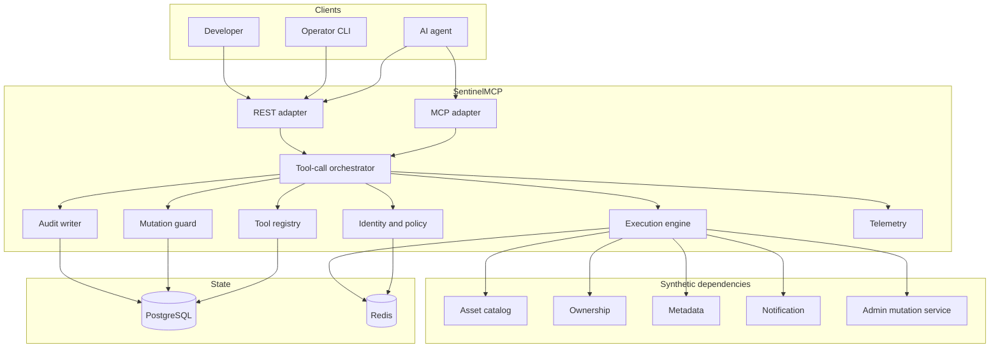
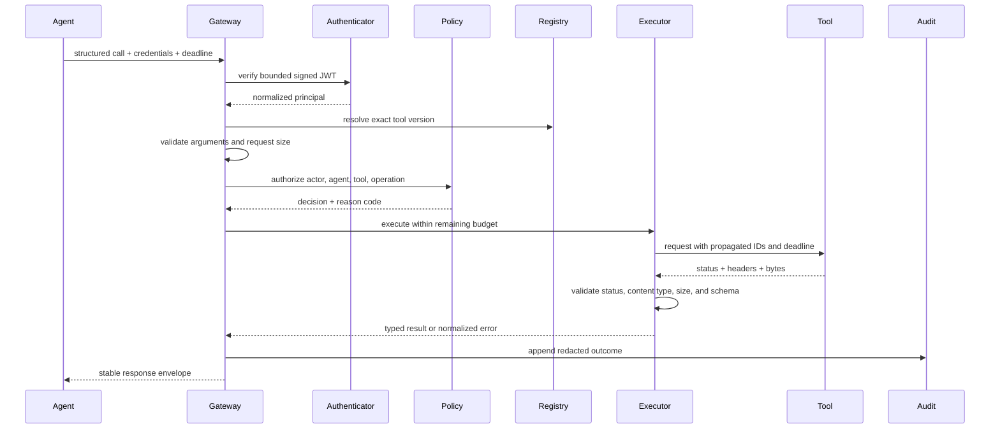

# Architecture

## 1. Purpose

SentinelMCP mediates structured tool calls between AI agents and external services. Its job is
to enforce policy and execution semantics at a boundary that agent runtimes otherwise treat as
a direct function call.

The system is both:

- a **data-plane proxy**, because every tool invocation passes through it; and
- a **control plane**, because it owns tool definitions, policies, safety controls, and
  operational evidence.

The first implementation is a modular monolith with separately deployed synthetic tool
services. The modules are designed around interfaces so that a proven bottleneck can be split
later without changing the public execution contract.

## 2. Goals and non-goals

### Goals

- One transport-independent lifecycle for REST and MCP requests.
- Explicit read-versus-mutation semantics.
- Fail-safe authorization and mutation confirmation.
- Bounded execution using deadlines, retries, and circuit breakers.
- Stable error envelopes even when an upstream response is malformed.
- Sufficient redacted evidence for audit, debugging, evaluation, and safe replay.
- Horizontal concurrency without relying on process-local correctness state.
- Reproducible reliability and performance measurements.

### Non-goals

- Choosing tools with an LLM or evaluating model reasoning inside the gateway.
- General workflow orchestration or durable multi-step agent planning.
- Claiming exactly-once effects across arbitrary external systems.
- Replaying calls against real production services.
- Storing raw secrets or unredacted arbitrary tool payloads.
- Recreating any employer-specific system, schema, or API.

## 3. System context

## 4. Module ownership

| Module | Owns | Must not own |
| --- | --- | --- |
| `adapters` | Protocol decoding, request limits, response encoding | Business policy or retries |
| `application` | End-to-end use cases and transaction boundaries | HTTP/MCP-specific types |
| `domain` | Stable IDs, operation classes, errors, decisions | Database or framework imports |
| `registry` | Versioned tool contracts and execution policy metadata | Caller authorization decisions |
| `policy` | Identity context, roles, permissions, allow/deny decisions | Tool execution |
| `mutation_guard` | Preview binding, confirmation consumption, idempotency | General authentication |
| `execution` | Deadline budgets, response decoding, retries, circuit breaker | Policy decisions |
| `audit` | Redaction and append-only audit event persistence | Request authorization |
| `telemetry` | Structured logs, traces, low-cardinality metrics | Business source of truth |
| `replay` | Reconstructing approved calls against synthetic targets | Bypassing current policy |
| `evaluation` | Scenario runner and outcome attribution | Production request handling |
| `fault_injection` | Test-only deterministic failure plans | Production runtime toggles |

Dependency direction is inward: adapters depend on application services; application services
coordinate domain-facing interfaces; infrastructure modules implement those interfaces. The
domain layer never imports FastAPI, SQLAlchemy, Redis, or OpenTelemetry.

### Phase 2 registry boundary

The `ToolRegistry` protocol is independent of storage technology. It exposes registration,
exact lookup, existence checks, deterministic identity/version lists, and latest-version
resolution using domain objects rather than database rows or unvalidated strings. The current
`InMemoryToolRegistry` protects registration and reads with a process-local lock. It validates
schemas and computes canonical content before atomically checking the exact reference.

Definitions are immutable after registration. An exact reference can produce only one of
three outcomes: a new insert, an explicit idempotent result for canonical-identical content,
or `ImmutableToolVersionConflict` for different content. It is never overwritten. The Phase 4
PostgreSQL adapter satisfies the same protocol and enforces the exact-reference invariant with
a unique constraint and transactional conflict handling.

Schema compilation and fingerprinting belong to `registry`; framework-independent identifier,
policy, definition, and error types belong to `domain`. Endpoint routing is intentionally
deferred in Phase 2 until a separate execution boundary exists.

### Execution boundary

The application `ToolExecutor` owns the lifecycle without importing FastAPI or HTTPX. It resolves
an exact definition, validates arguments, authorizes the principal, applies admission control,
rejects mutations from the ordinary path, resolves the exact runtime binding, and invokes the
adapter within one deadline. Eligible reads may make bounded attempts; successful output is always
validated. The executor returns immutable `ExecutionSuccess` or `ExecutionFailure` values instead
of leaking adapter exceptions.

`RuntimeToolBinding` is mutable operational state, not semantic registry content. It associates
an exact `ToolRef` with a configured `ToolAdapter`; endpoint and handler configuration therefore
does not alter the immutable definition fingerprint. The current binding registry is
process-local and lock-protected.

The synthetic and HTTP adapters share one protocol. The HTTP adapter performs one request,
classifies status before body interpretation, accepts bounded UTF-8 JSON success bodies, and
does not follow redirects. The FastAPI adapter translates JSON envelopes to and from the core
executor. See [Execution lifecycle](EXECUTION_LIFECYCLE.md) and
[ADR 0005](adr/0005-contract-identity-runtime-binding.md).

### Phase 5 security boundary

The REST adapter verifies a bounded signed JWT before constructing a core execution request.
Only the normalized subject, issuer, roles, and scopes enter the application layer. The
`ToolExecutor` requires an `AuthorizationPolicy`; it resolves the exact contract and validates
arguments before evaluating policy, then stops denied requests before mutation handling,
binding lookup, or adapter dispatch.

The current rule model matches tool identity and read/mutation operation class, optionally
requiring all listed roles and scopes. Explicit deny precedes allow, and no matching allow is
deny. Policy and verification keys are process configuration rather than persisted state.
See [Security model](SECURITY_MODEL.md) and
[ADR 0007](adr/0007-signed-jwt-and-exact-policy.md).

## 5. Canonical request context

Every accepted request receives or derives:

- `request_id`: unique attempt identifier generated at the edge;
- `trace_id`: distributed trace identifier propagated when valid, otherwise generated;
- `actor_id`: authenticated human or service principal;
- `agent_id`: logical agent identity supplied by a trusted caller claim;
- `tool_id` and immutable `tool_version`;
- absolute `deadline` based on the caller budget and server maximum;
- optional `idempotency_key` for mutations.

Identifiers used for debugging belong in logs and traces. They must not become Prometheus
labels because their cardinality is unbounded.

## 6. Read lifecycle

Authorization occurs before rate-limited upstream work. Audit persistence is part of the
contract for mutations and security decisions; read behavior during audit-store degradation
is an explicit policy configured and tested in a later phase.

## 7. Mutation lifecycle

Mutation preview and execution are separate commands.

1. Resolve an immutable tool version and validate arguments.
2. Authorize the actor for both the tool and the mutation class.
3. Canonicalize the validated arguments and compute a request digest.
4. Produce a preview containing the exact normalized arguments and a mutation warning.
5. Persist a random, single-use confirmation challenge as a hash, bound to principal issuer
   and subject, exact tool version, definition fingerprint, argument digest, and expiry.
6. Return the opaque confirmation token. No mutation has executed.
7. On confirmation, re-run validation and authorization against the same immutable tool
   version and atomically consume the challenge.
8. Require an idempotency key and claim its persistent record before dispatch.
9. Execute once from SentinelMCP's perspective, persist the terminal outcome, and audit it.

Changing any bound input invalidates the confirmation. Consumed and expired tokens fail
closed. A confirmation is authorization evidence, not a substitute for current authorization.

## 8. Persistence

Phase 4 implements the durable tool-contract subset described in
[PostgreSQL persistence](PERSISTENCE.md) and
[ADR 0006](adr/0006-postgresql-durable-tool-contract-store.md). `PostgresToolRegistry` uses
the same protocol as the in-memory registry; an exact-reference unique constraint and short
`READ COMMITTED` transactions arbitrate concurrent registration. Canonical bytes and
fingerprints are both retained and verified on reconstruction. Runtime bindings remain
process-local.

### PostgreSQL: durable source of truth

Tool versions, confirmation challenges, idempotency records, and payload-free audit events are
implemented as durable PostgreSQL records. Policy remains process configuration. Replay records use
a strict append-only local file store for the operator CLI rather than PostgreSQL.
Production schema changes use Alembic rather than runtime table creation. Audit APIs are
append-oriented but PostgreSQL is not claimed to be cryptographically tamper-proof.

### Redis: coordination and acceleration

Redis is not present. Phase 7 provides protocol-backed, process-local rate limiting, retry budgets,
and circuit state because the executable deployment has no multi-replica runtime. A horizontally
scaled deployment needs atomic shared implementations and service-level race tests before claiming
global bounds. Durable mutation safety remains in PostgreSQL and never exists only in Redis.

## 9. Execution semantics

The adapter implements status/content/body/schema normalization for one attempt. Phase 7 makes the
following statements executable in the application executor:

- A deadline is a budget for the whole call, not a fresh timeout for every retry.
- Retry delays consume that budget.
- Reads may retry only classified transient failures.
- Mutations never retry automatically in the current implementation; downstream idempotency-key
  propagation is not implemented.
- The executor inspects status, content type, body size, JSON validity, and response schema in
  that order. It never blindly calls `response.json()`.
- Circuit-breaker state is keyed by exact tool version. Generation-bound permits admit a bounded
  number of half-open probes in one process.
- Client cancellation stops waiting and attempts to cancel outbound work, but the audit event
  records that the upstream effect may be unknown.

Runtime bindings do not yet publish a stable endpoint identity, so tools sharing one dependency do
not share a circuit. See `FAILURE_MODEL.md` and `RELIABILITY.md` for the error taxonomy, reliability
limits, and ambiguous-outcome handling.

## 10. Observability

Traces capture the gateway, authentication, execution stages, retries, and audit boundary. Metrics
use only bounded labels such as operation class, finite route, normalized outcome, audit phase,
idempotency disposition, and circuit state. Exact tool names, principals, request/execution IDs,
URLs, tokens, and arbitrary errors are forbidden metric labels. Logs are structured, bounded, and
redacted before emission.

Audit events are not reconstructed from logs or traces. They are explicit domain records with
a versioned schema. Trace export failure must not mutate the business outcome; tracing does not
guarantee delivery, and metrics may be lost between scrapes. Required audit persistence follows the
read/mutation policy in [Audit contract](AUDIT.md).

## 11. Replay and operator CLI

`ReplayService` captures one exact successful request with its immutable definition fingerprint,
trusted historical IDs, verified principal identity, operation class, and bounded arguments. The
default policy permits replay only for read tools declaring `replay-safe` and currently bound to a
`SyntheticToolAdapter`. Contract drift, unavailable bindings, HTTP adapters, and mutation tools are
rejected before dispatch.

Replay is reauthorized through the current `ToolExecutor`. A `replay_attempted` audit intent is
required first, and the same target policy is evaluated again by the executor after its final
binding lookup. The standalone `sentinel` CLI uses these application services directly and stores
records in a local append-only file directory. See [Safe replay](REPLAY.md) and
[CLI reference](CLI.md).

## 12. Scaling path

### Official MCP boundary

The MCP v2 adapter uses the official SDK's low-level server handlers. Discovery reads exact
definitions from `ToolRegistry`; invocation decodes one reversible exact-version name and delegates
to `ToolExecutor` or `MutationService`. It does not own policy, retries, output validation, audit,
or telemetry. Trusted in-memory/stdio composition injects a principal explicitly. Streamable HTTP
bridges the existing `Authenticator` through the SDK bearer middleware and defaults to stateless
JSON transport. See [MCP integration](MCP.md).

At 10x traffic, scale stateless gateway replicas horizontally. PostgreSQL connection pools,
Redis command volume, audit write throughput, and high-cardinality telemetry are expected
bottlenecks and must be measured before extraction.

Likely future split points are audit ingestion and evaluation workers because they can consume
versioned events asynchronously. Policy and mutation safety remain in the synchronous path
until a benchmark demonstrates a reason to separate them. A service split is not considered a
performance fix unless queueing, consistency, and failure behavior are measured.

## 13. Deployment topology

Local Docker Compose currently provisions PostgreSQL, Prometheus, and Grafana. The gateway runs on
the host and exposes its private Prometheus registry at `/metrics`; no Redis, gateway container, or
OpenTelemetry Collector is claimed by the current stack. Production deployment manifests are out
of scope until the interfaces and failure behavior stabilize.
