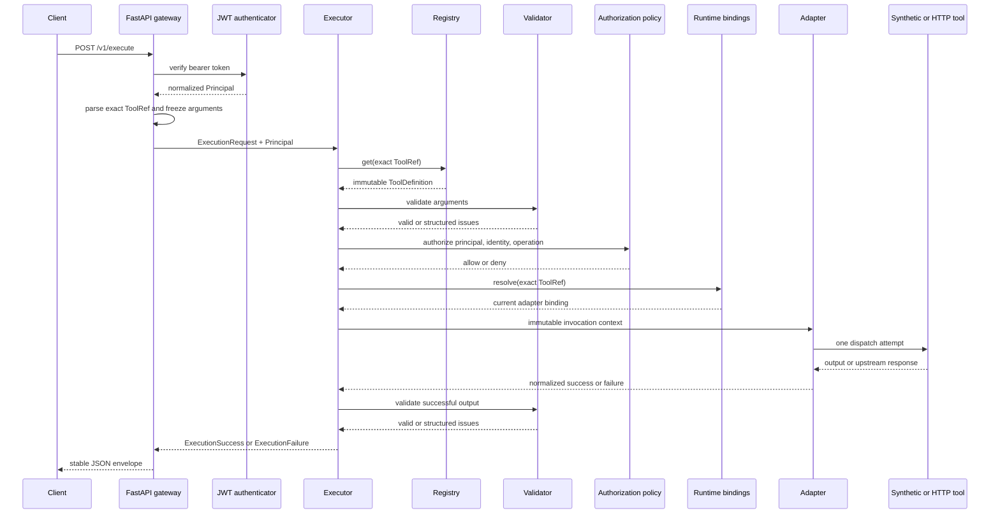

# Execution Lifecycle

## Status and scope

Phases 3 through 9 implement one real execution path from a signed-JWT-authenticated FastAPI
request to an exact immutable tool contract, authorization decision, runtime binding, adapter
invocation, output validation, and stable response. The contract registry can be in memory or
PostgreSQL. Mutations use separate durable preview and confirmation endpoints backed by
PostgreSQL. Reads have request-wide deadlines, bounded retries, retry budgets, rate limiting, and
circuit breaking. Phase 8 adds audit and telemetry. Phase 9 adds constrained synthetic replay and
a local operator CLI over the same executor. Phase 10 adds official MCP transports over that
executor, Phase 11 adds deterministic fault evaluation, and Phase 12 adds reproducible profiling
and benchmark evidence.

The public demo registers only read tools. A registered mutation is rejected by ordinary
`ToolExecutor.execute` with `mutation_not_supported`; supported mutation callers must use
`MutationService` so the executor cannot bypass confirmation and idempotency safeguards.

## Identities

Three identifiers have different purposes:

- **Tool identity** is the exact `ToolRef`, such as `demo.math.add@1.0.0`. It selects one
  immutable semantic contract and never means latest.
- **Request identity** is an internally generated UUID4 for one accepted gateway request.
- **Execution identity** is a separate internally generated UUID4 for one dispatch attempt.
  Retries retain the request ID and receive a new execution ID.

Malformed gateway envelopes receive a generated request ID but no execution ID because they do
not create a typed core execution. UUID4 provides strong uniqueness, not temporal ordering.

`ExecutionContext` also records the exact reference, definition fingerprint, timezone-aware
wall-clock start time, and a process-local monotonic start value. Wall time supports human
diagnosis; duration uses only monotonic subtraction.

## Lifecycle



Credentials are verified before entering the executor. Arguments are validated before policy,
runtime binding resolution, or adapter invocation. Policy is evaluated before mutation
handling and bindings. Unknown exact versions, invalid input, unauthenticated or unauthorized
callers, unbound tools, and mutations therefore perform no tool work.

## Mutation lifecycle

`POST /v1/mutations/preview` and `POST /v1/mutations/confirm` share the executor's exact lookup,
schema validation, and authorization stages. Preview persists a hashed challenge and returns
the raw token without resolving a runtime binding. Confirm re-runs current authorization,
resolves the binding, and atomically consumes the challenge while claiming a durable
idempotency record before one adapter dispatch.

The challenge binds verified principal issuer/subject, exact tool reference, definition
fingerprint, canonical argument digest, and expiry. Same-key duplicates with the same semantic
request recover a pending or terminal record; a different semantic request conflicts. See
[Mutation safety](MUTATION_SAFETY.md) for transactions, races, and crash semantics.

## Contract identity and runtime binding

An immutable `ToolDefinition` answers: "What inputs, outputs, and operation semantics does this
exact version promise?" Its endpoint-independent content is fingerprinted.

A `RuntimeToolBinding` answers: "Which configured adapter executes this exact version now?"
Bindings are mutable operational state and may be replaced without changing contract identity.
They hold adapter instances, whose configuration may include an HTTP target or an in-process
handler. Endpoints, credentials, and deployment details are not added to tool fingerprints.

The `RuntimeBindingResolver` protocol keeps the executor independent of binding storage. Phase 3
provides a thread-safe process-local implementation only.

## Adapter contract

`ToolAdapter.execute` receives an immutable `AdapterInvocation` and returns `AdapterSuccess` or
`AdapterFailure`. The executor has no FastAPI or HTTPX dependency. Phase 3 provides:

- `SyntheticToolAdapter` for deterministic public in-process tools;
- `HTTPToolAdapter` for one POST attempt using an injected HTTPX client.

Adapters never retry. Unexpected exceptions are converted to a safe internal or adapter failure
without exception representations or stack traces in the public result.

## HTTP normalization

The HTTP adapter processes responses in this order:

1. classify connection or timeout failure;
2. inspect HTTP status;
3. reject `204 No Content` as a malformed successful response;
4. require `application/json` or an `application/*+json` media type with UTF-8 charset;
5. enforce declared and streamed body-size limits;
6. decode UTF-8 and parse JSON while rejecting duplicate object keys;
7. detach and freeze the parsed JSON value;
8. allow the executor to validate the exact output schema.

Non-success statuses are classified before media-type or JSON handling. Therefore a plain-text
`401` is `upstream_authentication_failed`, never a JSON decoding failure. Redirects are not
followed. The default successful-response limit is 1,048,576 bytes and configuration is capped
at 10,000,000 bytes. Raw response and error bodies are not stored in execution errors.

`200` is only transport success. SentinelMCP still rejects unsupported media types, invalid
UTF-8, malformed or duplicate-key JSON, over-limit bodies, and output-schema violations.

## Error categories

The executor uses one stable enum and a bounded `ExecutionError` containing a safe message,
optional upstream status, and optional schema issues. Implemented categories are:

- request, security, and routing: `invalid_request`, `authentication_failed`, `tool_not_found`,
  `input_validation_failed`, `authorization_failed`, `mutation_not_supported`,
  `mutation_confirmation_invalid`, `idempotency_conflict`, `idempotency_in_progress`,
  `mutation_state_unavailable`, `mutation_outcome_unknown`, `binding_not_found`;
- adapter and status: `adapter_failure`, `upstream_bad_request`,
  `upstream_authentication_failed`, `upstream_authorization_failed`, `upstream_not_found`,
  `upstream_conflict`, `upstream_rate_limited`, `upstream_status_error`,
  `upstream_server_error`, `upstream_unavailable`, `upstream_timeout`;
- response contract: `upstream_invalid_content_type`, `upstream_malformed_response`,
  `upstream_response_too_large`, `output_validation_failed`;
- unexpected defect: `internal_execution_error`.

Messages never include raw arguments, bodies, credentials, exception text, or stack traces.

## REST gateway

`POST /v1/execute` accepts an exact structured reference:

```json
{
  "tool": {"namespace": "demo.math", "name": "add", "version": "1.0.0"},
  "arguments": {"a": 2, "b": 3}
}
```

A success returns HTTP 200 with request/execution IDs, exact tool text, monotonic duration, and
validated result. Missing or invalid credentials use 401; denied policy uses 403; invalid
envelopes or arguments use 422; unknown tools use 404; blocked mutations use 409; missing
bindings and upstream unavailability use 503; upstream timeout uses 504; internal defects use
500; other adapter/upstream/response-contract failures use 502. External HTTP status is an API
mapping, not the internal error taxonomy.

The runnable demo ASGI app is `sentinelmcp.adapters.rest.demo:app`.

## Synthetic tools

- `demo.math.add@1.0.0` adds two JSON numbers.
- `demo.catalog.lookup@1.0.0` returns a nested public synthetic catalog record.
- `demo.profile.get@1.0.0` returns a nested public synthetic profile.

All definitions use the real immutable registry, schemas, bindings, executor, and output checks.

## Reliability controls

The executor creates one absolute monotonic deadline after authorization and rate admission. Reads
retry only transient upstream rate-limit, server, timeout, and unavailable failures. Each retry
requires both its contract attempt allowance and one aggregate retry-budget token, then sleeps for
capped exponential full jitter without exceeding the deadline. Every adapter attempt is bounded by
the remaining deadline. Mutations are always single-attempt.

The three-state circuit breaker counts dependency-health failures only and uses generation-bound,
bounded half-open probes. Rate limiting is keyed by verified principal plus exact tool. Public
rejections expose bounded `retry_after_ms` guidance. See [Reliability controls](RELIABILITY.md).

## Deliberate limitations

- Rate limiting, retry budgets, and circuits default to no-op/unlimited until explicitly injected.
- Built-in reliability state is process-local and retains observed keys for the process lifetime;
  it does not enforce global multi-replica bounds.
- There is no endpoint allowlist, DNS/IP policy, credential injection, or redirect policy beyond
  refusing redirects. The HTTP adapter is not production-safe for untrusted target configuration.
- There is no token issuance, remote key discovery, revocation, persisted policy, delegated
  agent identity, or distributed binding coordination.
  Mutation safety is durable, but downstream idempotency propagation and automated
  reconciliation are not implemented. Runtime bindings remain process-local.
- Replay is limited to exact, explicitly marked synthetic read bindings. Its CLI file store and
  default audit store are local to one host and do not provide a hosted operator security boundary.
- MCP Streamable HTTP is stateless and stdio has no inherent Sentinel authentication. Each
  transport must be composed with an explicit principal resolver; the default denies all calls.
- Client cancellation can cancel an in-process waiting adapter, but cannot prove cancellation of
  an already delivered external mutation side effect.

## Audit and observability

The executor emits finite stage spans for exact lookup, input validation, authorization, rate
admission, runtime binding, attempts, output validation, and audit recording. The REST adapter owns
gateway and authentication spans. Instrumentation uses protocols and OpenTelemetry API types; core
domain objects do not depend on an SDK.

Read terminal audit is attempted after the normalized result exists, and failure preserves that
result. Mutations append a durable dispatch intent before the adapter call. A failed intent append
prevents dispatch; a failed completion append after dispatch returns `mutation_outcome_unknown`.
See [Audit contract](AUDIT.md) and [Observability](OBSERVABILITY.md).

## Replay lifecycle

Successful CLI executions may opt into a strict replay record. A replay resolves the exact current
contract and binding, compares the historical definition fingerprint, applies the synthetic-only
target policy, records an audit intent, and runs current validation and authorization. Dry run
returns the resulting plan without adapter dispatch. Actual replay gives the policy to the executor
as a final binding guard immediately before dispatch. See [Safe replay](REPLAY.md).

## MCP lifecycle

MCP discovery lists deterministic exact versions with registered schemas. A call decodes the
canonical MCP name to one `ToolRef`; reads enter `ToolExecutor`, while mutation `preview` and
`confirm` actions enter `MutationService`. Structured MCP results are only transport encodings of
the resulting application values. See [MCP integration](MCP.md).
