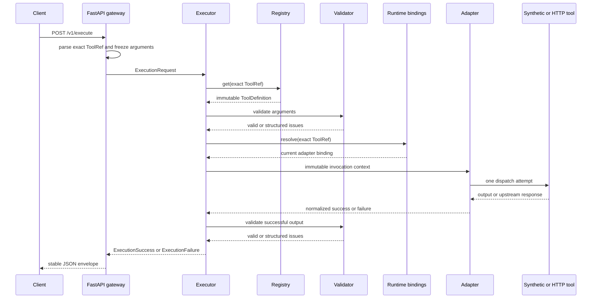

# Execution Lifecycle

## Status and scope

Phase 3 implements one real execution path from a FastAPI request to an exact immutable tool
contract, runtime binding, adapter invocation, output validation, and stable response. It does
not implement authentication, authorization, mutation confirmation, persistence, retries,
circuit breaking, telemetry, replay, or benchmarks.

The public demo registers only read tools. A registered mutation is rejected before binding
resolution with `mutation_not_supported` until the confirmation and idempotency phase exists.

## Identities

Three identifiers have different purposes:

- **Tool identity** is the exact `ToolRef`, such as `demo.math.add@1.0.0`. It selects one
  immutable semantic contract and never means latest.
- **Request identity** is an internally generated UUID4 for one accepted gateway request.
- **Execution identity** is a separate internally generated UUID4 for one dispatch attempt.
  Phase 3 makes one attempt, but the distinction prevents a future retry from being confused
  with the caller-visible request.

Malformed gateway envelopes receive a generated request ID but no execution ID because they do
not create a typed core execution. UUID4 provides strong uniqueness, not temporal ordering.

`ExecutionContext` also records the exact reference, definition fingerprint, timezone-aware
wall-clock start time, and a process-local monotonic start value. Wall time supports human
diagnosis; duration uses only monotonic subtraction.

## Lifecycle



Arguments are validated before runtime binding resolution or adapter invocation. Unknown exact
versions, invalid input, unbound tools, and mutations therefore perform no tool work.

## Contract identity and runtime binding

An immutable `ToolDefinition` answers: "What inputs, outputs, and operation semantics does this
exact version promise?" Its endpoint-independent content is fingerprinted.

A `RuntimeToolBinding` answers: "Which configured adapter executes this exact version now?"
Bindings are mutable operational state and may be replaced without changing contract identity.
They hold adapter instances, whose configuration may include an HTTP target or an in-process
handler. Endpoints, credentials, and deployment details are not added to tool fingerprints.

The `RuntimeBindingResolver` protocol keeps the executor independent of binding storage. Phase 3
provides a thread-safe process-local implementation only.

## Adapter contract

`ToolAdapter.execute` receives an immutable `AdapterInvocation` and returns `AdapterSuccess` or
`AdapterFailure`. The executor has no FastAPI or HTTPX dependency. Phase 3 provides:

- `SyntheticToolAdapter` for deterministic public in-process tools;
- `HTTPToolAdapter` for one POST attempt using an injected HTTPX client.

Adapters never retry. Unexpected exceptions are converted to a safe internal or adapter failure
without exception representations or stack traces in the public result.

## HTTP normalization

The HTTP adapter processes responses in this order:

1. classify connection or timeout failure;
2. inspect HTTP status;
3. reject `204 No Content` as a malformed successful response;
4. require `application/json` or an `application/*+json` media type with UTF-8 charset;
5. enforce declared and streamed body-size limits;
6. decode UTF-8 and parse JSON while rejecting duplicate object keys;
7. detach and freeze the parsed JSON value;
8. allow the executor to validate the exact output schema.

Non-success statuses are classified before media-type or JSON handling. Therefore a plain-text
`401` is `upstream_authentication_failed`, never a JSON decoding failure. Redirects are not
followed. The default successful-response limit is 1,048,576 bytes and configuration is capped
at 10,000,000 bytes. Raw response and error bodies are not stored in execution errors.

`200` is only transport success. SentinelMCP still rejects unsupported media types, invalid
UTF-8, malformed or duplicate-key JSON, over-limit bodies, and output-schema violations.

## Error categories

Phase 3 uses one stable enum and a bounded `ExecutionError` containing a safe message, optional
upstream status, and optional schema issues. Implemented categories are:

- request and routing: `invalid_request`, `tool_not_found`, `input_validation_failed`,
  `mutation_not_supported`, `binding_not_found`;
- adapter and status: `adapter_failure`, `upstream_bad_request`,
  `upstream_authentication_failed`, `upstream_authorization_failed`, `upstream_not_found`,
  `upstream_conflict`, `upstream_rate_limited`, `upstream_status_error`,
  `upstream_server_error`, `upstream_unavailable`, `upstream_timeout`;
- response contract: `upstream_invalid_content_type`, `upstream_malformed_response`,
  `upstream_response_too_large`, `output_validation_failed`;
- unexpected defect: `internal_execution_error`.

Messages never include raw arguments, bodies, credentials, exception text, or stack traces.

## REST gateway

`POST /v1/execute` accepts an exact structured reference:

```json
{
  "tool": {"namespace": "demo.math", "name": "add", "version": "1.0.0"},
  "arguments": {"a": 2, "b": 3}
}
```

A success returns HTTP 200 with request/execution IDs, exact tool text, monotonic duration, and
validated result. Invalid envelopes or arguments use 422; unknown tools use 404; blocked
mutations use 409; missing bindings and upstream unavailability use 503; upstream timeout uses
504; internal defects use 500; other adapter/upstream/response-contract failures use 502.
External HTTP status is an API mapping, not the internal error taxonomy.

The runnable demo ASGI app is `sentinelmcp.adapters.rest.demo:app`.

## Synthetic tools

- `demo.math.add@1.0.0` adds two JSON numbers.
- `demo.catalog.lookup@1.0.0` returns a nested public synthetic catalog record.
- `demo.profile.get@1.0.0` returns a nested public synthetic profile.

All definitions use the real immutable registry, schemas, bindings, executor, and output checks.

## Deliberate limitations

- There is no retry, backoff, circuit breaker, or request-wide deadline budget.
- HTTP has one configured per-attempt timeout; timeout is classified and returned.
- There is no endpoint allowlist, DNS/IP policy, credential injection, or redirect policy beyond
  refusing redirects. The HTTP adapter is not production-safe for untrusted target configuration.
- There is no authentication, authorization, rate limiting, mutation confirmation, idempotent
  execution, persistence, distributed binding coordination, audit, telemetry, or replay.
- There is no MCP transport adapter or CLI execution command yet. Both can call the same core
  executor once their boundary contracts are implemented.
