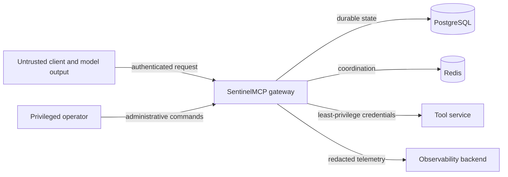

# Threat Model

## Scope

This document covers the SentinelMCP gateway, its durable and coordination stores, synthetic
tool services, observability pipeline, replay tooling, and operator CLI. It assumes TLS is
terminated by trusted infrastructure in hosted environments; transport deployment is not yet
implemented.

AI-generated tool arguments are **untrusted input**. An authenticated agent is not inherently
authorized, and model confidence is never treated as security evidence.

## Assets

- Authorization policy and identity claims
- Tool definitions, versions, schemas, and endpoint configuration
- Mutation confirmation and idempotency records
- Upstream credentials and signing material
- Audit integrity and availability
- Tool-call arguments and responses, which may contain sensitive fields
- Service availability and circuit/rate-limit coordination state
- Replay artifacts and evaluation datasets

## Actors

- Authorized human operators and service principals
- AI agents acting under a principal's delegated identity
- Tool-service maintainers
- Unauthenticated internet clients
- Authenticated but unauthorized or compromised callers
- A compromised or malfunctioning upstream tool
- A contributor or dependency introducing malicious code

## Trust boundaries

Crossing a boundary requires explicit validation. Internal network location alone is not an
authorization signal.

## Security invariants

1. No tool executes before authentication, schema validation, and authorization succeed.
2. A sensitive mutation executes only after a matching, unexpired, single-use confirmation is
   atomically consumed.
3. Reusing an idempotency key with different arguments is rejected.
4. Raw secrets and configured sensitive fields never enter logs, metrics, traces, or replay
   records.
5. Replay cannot target arbitrary endpoints or bypass current authorization.
6. Fault injection cannot be enabled through the public production request path.
7. Mutation safety fails closed when required durable or coordination state is unavailable.

## Phase 2 implemented controls

- Tool definitions contain no credential or secret fields and are detached from caller-owned
  mutable containers before registration.
- Input and output contracts use a fixed Draft 2020-12 validator. Relative and remote `$ref` and
  `$dynamicRef` values are rejected before compilation, so validation performs no network I/O.
- Document-local JSON Pointers and anchors are resolved at registration. Missing targets,
  duplicate anchors, nested schema resources, and direct reference cycles are rejected.
- Schema byte size, node count, and depth are bounded. Runtime JSON depth, node count, and
  reported issue count are also bounded.
- Exact versions cannot be overwritten. Canonical bytes are compared in addition to SHA-256
  fingerprints, so registry correctness does not assume collision resistance alone.

## Threats and controls

| Threat | Planned controls | Residual risk / validation |
| --- | --- | --- |
| Forged identity | Validate issuer, audience, expiry, signature, and algorithm; reject caller-supplied actor fields | Identity provider compromise remains external |
| Confused deputy | Bind actor and agent claims; authorize resource-independent tool action; never trust model text as a role | Delegation model needs explicit tests |
| Argument injection | Pydantic and JSON Schema validation; reject unknown fields by default; length and depth limits | A valid but harmful argument still needs policy |
| SSRF through tool registration | Administrative registration permission; endpoint allowlist; reject loopback, link-local, metadata, and unsafe redirects | DNS rebinding requires resolution-time checks |
| Schema or payload denial of service | Request/body limits; schema complexity limits; bounded JSON depth; execution deadlines | CPU exhaustion needs load tests |
| Confirmation theft or replay | Store token hashes only; exact-request binding; short expiry; atomic one-time consume | A stolen live token can be used by the bound identity until expiry |
| Preview/execute mismatch | Immutable tool version plus canonical argument and policy digest | Canonicalization requires cross-version test vectors |
| Duplicate mutation | Unique idempotency scope and digest; upstream key propagation when supported | Unknown outcome remains possible without upstream support |
| Retry amplification | Retry budgets, jitter, global deadline, circuit breaker, no unsafe mutation retry | Multiple gateway tiers can still amplify if budgets are not propagated |
| Malicious upstream response | Status/content-type/size/schema checks before decoding; normalized error envelope | Semantically malicious valid JSON needs tool-specific validation |
| Credential disclosure | Secret manager integration, per-tool credentials, redaction before telemetry, no credentials in registry rows | Memory inspection is outside current scope |
| Audit tampering | Insert-only application role, event hashes and sequence checks, restricted retention administration | Database administrator can still alter storage; true WORM is future work |
| Telemetry data leak | Allowlisted attributes, sensitive-field filters, bounded body previews, no raw confirmation tokens | Tool-specific secrets need registry annotations |
| Cardinality attack | Bounded metric labels; request and trace IDs only in logs/traces | Unbounded tool names are prevented by registry constraints |
| Rate-limit bypass | Redis atomic limiter keyed by trusted principal and policy scope | Redis outage behavior must be explicit and tested |
| Circuit-state poisoning | Classify only relevant failures; key by immutable tool endpoint; bounded half-open probes | Shared dependency failures can still cascade across tools |
| Replay abuse | Synthetic targets only by default; privileged command; reauthorization; dry-run mode; audit replay attempts | Operator compromise remains high impact |
| Fault-injection exposure | Separate test configuration and package; startup refusal in production mode | Misconfigured deployment needs CI policy checks |
| Supply-chain compromise | Pinned lockfile in a later phase, dependency review, hashes in release builds, minimal dependencies | CI runner and package index are external trust roots |

## Sensitive-data handling

Tool schemas will support sensitivity annotations for fields. Redaction occurs before data is
handed to logging, tracing, audit serialization, or replay persistence. Hashes are used only
when equality correlation is required and are keyed where dictionary attacks are plausible.

Request and response payloads are not Prometheus labels. Error messages returned to clients do
not include credentials, stack traces, raw upstream bodies, or internal endpoint details.

## Abuse cases to test

- Concurrent use of the same confirmation token
- Confirmation token used with changed arguments, identity, tool version, or idempotency key
- One idempotency key submitted concurrently with same and different payloads
- Registered endpoint redirecting to a cloud metadata address
- Upstream `200 text/plain`, oversized JSON, duplicate keys, invalid UTF-8, and deeply nested data
- Caller-controlled strings containing log delimiters or trace attribute injection
- Rate-limit and circuit-breaker races across multiple gateway processes
- Replay request targeting a non-synthetic host
- Production startup with fault injection enabled

## Out of scope for the first release

- Hardware-backed keys and confidential computing
- Formal policy verification
- Multi-region active-active mutation execution
- WORM or third-party audit notarization
- Sandboxing arbitrary user-provided executable tools
