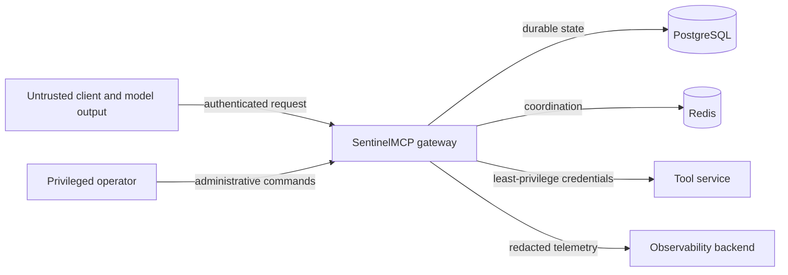

# Threat Model

## Scope

This document covers the SentinelMCP gateway, its durable and coordination stores, synthetic
tool services, observability pipeline, replay tooling, and operator CLI. It assumes TLS is
terminated by trusted infrastructure in hosted environments; transport deployment is not yet
implemented.

AI-generated tool arguments are **untrusted input**. An authenticated agent is not inherently
authorized, and model confidence is never treated as security evidence.

## Assets

- Authorization policy and identity claims
- Tool definitions, versions, schemas, and endpoint configuration
- Mutation confirmation and idempotency records
- Upstream credentials and signing material
- Audit integrity and availability
- Tool-call arguments and responses, which may contain sensitive fields
- Service availability and circuit/rate-limit coordination state
- Replay artifacts and evaluation datasets

## Actors

- Authorized human operators and service principals
- AI agents acting under a principal's delegated identity
- Tool-service maintainers
- Unauthenticated internet clients
- Authenticated but unauthorized or compromised callers
- A compromised or malfunctioning upstream tool
- A contributor or dependency introducing malicious code

## Trust boundaries

Crossing a boundary requires explicit validation. Internal network location alone is not an
authorization signal.

## Security invariants

These are target invariants for the first production-capable release, not a claim that every
control is implemented. Phase 5 implements signed-JWT authentication and default-deny
authorization for execution, Phase 6 implements durable mutation confirmation and local
idempotency arbitration, Phase 7 implements optional process-local reliability controls, Phase 8
implements durable audit and bounded telemetry, Phase 9 implements constrained synthetic replay,
and Phase 13 implements bounded REST ingress plus an SSRF-resistant direct outbound HTTP policy.
Rate controls remain process-local rather than cross-replica, so the project is not presented as
production-ready.

1. No tool executes before authentication, schema validation, and authorization succeed.
2. A sensitive mutation executes only after a matching, unexpired, single-use confirmation is
   atomically consumed.
3. Reusing an idempotency key with different arguments is rejected.
4. Payloads are excluded from audit and telemetry; replay rejects common sensitive field names and
   is restricted to explicitly approved synthetic data.
5. Replay cannot target arbitrary endpoints or bypass current authorization.
6. Fault injection cannot be enabled through the public production request path.
7. Mutation safety fails closed when required durable or coordination state is unavailable.

## Phase 2 implemented controls

- Tool definitions contain no credential or secret fields and are detached from caller-owned
  mutable containers before registration.
- Input and output contracts use a fixed Draft 2020-12 validator. Relative and remote `$ref` and
  `$dynamicRef` values are rejected before compilation, so validation performs no network I/O.
- Document-local JSON Pointers and anchors are resolved at registration. Missing targets,
  duplicate anchors, nested schema resources, and direct reference cycles are rejected.
- Schema byte size, node count, and depth are bounded. Runtime JSON depth, node count, and
  reported issue count are also bounded.
- Exact versions cannot be overwritten. Canonical bytes are compared in addition to SHA-256
  fingerprints, so registry correctness does not assume collision resistance alone.

## Phase 3 implemented controls

- Gateway requests select one exact version; the executor never substitutes `latest`.
- Arguments are detached and schema-validated before binding resolution or adapter dispatch.
- Ordinary executor calls reject mutations so no unguarded local path reaches an adapter.
- Runtime targets are separate from immutable contracts. HTTP target URLs reject embedded
  credentials and fragments, and redirects are not followed. Phase 13 additionally requires HTTPS
  by default, supports an exact normalized host allowlist, validates every DNS answer, rejects
  non-global and IPv4-transition addresses, and pins direct requests to an approved address while
  preserving the original Host header and TLS SNI.
- Non-success HTTP status is classified before content-type or JSON parsing. Successful bodies
  require a supported UTF-8 JSON media type, bounded bytes, unique object keys, and valid JSON.
- Successful adapter output is detached and validated against the exact registered output schema.
- Public errors contain no raw bodies, exception text, credentials, or stack traces.

Runtime target configuration and any explicit opt-out permitting plaintext or non-global
addresses remain trusted administrative concerns. Per-tool credential injection and
administrative binding authorization are not implemented. Deployment-supplied HTTP proxies must
enforce equivalent destination policy because their routing is outside the direct socket boundary.

## Phase 13 implemented controls

- REST ingress buffers no more than the configured request-body limit before JSON decoding and
  rejects oversized declared or chunked bodies without reflecting payload data.
- Outbound URLs permit only absolute HTTP(S), reject embedded credentials and fragments, and use
  HTTPS by default.
- Optional host allowlists are exact after IDNA/case/trailing-dot normalization; wildcards are not
  accepted.
- Every DNS answer must be a bounded, syntactically valid global address. Loopback, private,
  link-local, unspecified, multicast, reserved, IPv4-mapped IPv6, 6to4, and Teredo targets fail
  closed.
- A selected approved address is placed in the actual connection URL, while the original hostname
  remains the HTTP Host header and TLS SNI. This removes the direct DNS resolution/use race.
- Resolver failure, mixed public/private answers, excessive answer sets, unsafe schemes, and policy
  mismatches return the payload-free `outbound_target_rejected` failure without dispatch.

## Phase 5 implemented controls

- The REST execution boundary accepts only a bounded Bearer token and normalizes all expected
  credential failures to one non-diagnostic `401` response.
- JWT verification binds a configured key ID to an explicit algorithm allowlist and verifies
  signature, issuer, audience, expiry, issued-at, and optional not-before.
- Unverified headers select only a preconfigured key; token-controlled key URLs and remote key
  retrieval are absent.
- Only subject, validated issuer, bounded roles, and bounded scopes survive as an immutable
  principal. The raw token and arbitrary claims are not propagated.
- Every executor composition requires an authorization policy. Matching deny precedes allow,
  and no matching allow is deny.
- Policy distinguishes exact tool identity and operation class, so read permission does not
  imply mutation permission.
- Missing identity, invalid credentials, denied policy, and policy exceptions stop before
  runtime binding resolution or adapter invocation.

Verification keys and policies are currently trusted process configuration. Token issuance,
key distribution, revocation, policy administration, delegated-agent identity, and tenant
isolation are not implemented. See [Security model](SECURITY_MODEL.md).

## Phase 6 implemented controls

- Raw confirmation secrets are generated with operating-system randomness and only SHA-256
  digests are persisted.
- Challenges expire and are bound to verified principal issuer/subject, exact tool version,
  immutable definition fingerprint, and RFC 8785 argument digest.
- PostgreSQL conditionally consumes a challenge in the same transaction that creates the
  idempotency claim; rejected and losing transactions leave no orphan idempotency row.
- The ordinary executor continues to reject mutations, preventing an alternate local path
  around the durable guard.
- A unique scoped key and semantic request digest arbitrate concurrent duplicates. Different
  requests conflict, while identical requests recover pending or terminal state.
- Mutation-state failure before a claim fails closed. Ambiguous post-dispatch outcomes are not
  automatically retried.

The live token remains bearer material for its bound principal until use or expiry. PostgreSQL
administrator compromise, target-side duplicate behavior, and process failure between external
effect and terminal persistence remain residual risks. See [Mutation safety](MUTATION_SAFETY.md).

## Phase 7 implemented controls

- One absolute monotonic deadline bounds backoff and every adapter attempt.
- Reads retry only classified transient failures; mutation dispatch is always single-attempt.
- Full-jitter backoff and a separate exact-tool retry budget bound local retry amplification.
- Rate-limit scopes derive from verified identity and exact tool identity.
- The circuit breaker counts only dependency-health failures and uses generation-bound,
  concurrency-limited half-open probes.
- Control-admission failures fail the request, while post-dispatch bookkeeping cannot replace an
  authoritative tool outcome.

These controls are disabled unless explicitly injected and are process-local. They neither enforce
global multi-replica limits nor bound retained scope records; deployments with those requirements
must provide protocol implementations with atomic shared state and bounded retention.

## Phase 8 implemented controls

- Audit records use a strict versioned schema with no argument/result payload fields.
- Mutation dispatch requires a durable audit intent; post-dispatch audit failure becomes an honest
  unknown outcome.
- Recursive logging redaction bounds keys, values, depth, and collection size before JSON emission.
- Span names and attributes are allowlisted, and automatic exception text recording is disabled.
- Prometheus labels are finite and omit exact tools, principals, IDs, URLs, tokens, and free-form
  errors.
- Telemetry provider/exporter failures cannot replace an application outcome.

Audit storage remains administrator-mutable and therefore is not a WORM or cryptographically
tamper-proof ledger. Trace and metric delivery are best effort.

## Phase 9 implemented controls

- Replay records bind exact tool versions to the historical definition fingerprint and trusted
  execution identifiers.
- Records are bounded, strict, append-only files; duplicate keys, schema drift, malformed names,
  and oversized documents fail closed.
- Recursive normalized field-name checks reject common credential, cookie, token, and secret keys.
- Default replay requires a read operation, an explicit `replay-safe` capability, and the current
  in-process synthetic adapter.
- Current authorization is evaluated for dry run and execution. Historical permission is not
  accepted as current authority.
- A replay audit intent is required before dispatch, and target policy is checked again after the
  executor's final binding lookup to prevent a target-swap race.

The field-name denylist cannot identify secrets stored under innocuous names. The standalone CLI's
audit store is process-local, and its replay records are not encrypted or tamper-proof. Only
non-sensitive synthetic arguments are supported by the default workflow.

## Threats and controls

| Threat | Planned controls | Residual risk / validation |
| --- | --- | --- |
| Forged identity | Implemented bounded signature, issuer, audience, time, key-ID, and algorithm validation; caller identity comes only from verified claims | Identity-provider and signing-key compromise remain external; revocation is absent |
| Confused deputy | Implemented exact tool/operation authorization from normalized roles and scopes; model text is never a role | Delegated-agent and tenant models are not implemented |
| Argument injection | Pydantic and JSON Schema validation; reject unknown fields by default; length and depth limits | A valid but harmful argument still needs policy |
| SSRF through tool registration | Implemented HTTPS default, optional exact host allowlist, all-answer DNS/IP validation, redirect refusal, and direct IP pinning | Explicit internal-network opt-out and deployment-supplied proxies remain administrative trust boundaries |
| Schema or payload denial of service | Implemented raw request/response limits, schema complexity limits, bounded JSON depth, and execution deadlines | Aggregate CPU and connection exhaustion still need deployment limits and load tests |
| Confirmation theft or replay | Store token hashes only; exact-request binding; short expiry; atomic one-time consume | A stolen live token can be used by the bound identity until expiry |
| Preview/execute mismatch | Immutable tool version plus canonical argument and policy digest | Canonicalization requires cross-version test vectors |
| Duplicate mutation | Unique idempotency scope and digest; upstream key propagation when supported | Unknown outcome remains possible without upstream support |
| Retry amplification | Retry budgets, jitter, global deadline, circuit breaker, no unsafe mutation retry | Multiple gateway tiers can still amplify if budgets are not propagated |
| Malicious upstream response | Status/content-type/size/schema checks before decoding; normalized error envelope | Semantically malicious valid JSON needs tool-specific validation |
| Credential disclosure | Secret manager integration, per-tool credentials, redaction before telemetry, no credentials in registry rows | Memory inspection is outside current scope |
| Audit tampering | Append-oriented application API, strict rows, conflicting-ID detection, restricted database role recommended | Database administrator can still alter storage; signing, sequence hashes, and WORM retention are not implemented |
| Telemetry data leak | Allowlisted trace attributes, recursive structured-log redaction, no payloads or tokens | Logs and traces still contain bounded correlation metadata and require access control |
| Cardinality attack | Finite metric labels; exact tools, principals, request IDs, and execution IDs omitted | Additional metrics must preserve the allowlist |
| Rate-limit bypass | Implemented trusted-principal/exact-tool token bucket | State is process-local; replicas do not share a global limit |
| Circuit-state poisoning | Implemented health-failure classification and generation-bound probes | Exact-tool local keys do not coordinate shared endpoints or replicas |
| Replay abuse | Implemented synthetic/read/capability target policy, current reauthorization, dry-run mode, pre-dispatch audit, fingerprint check, and final binding guard | CLI audit is process-local; file records are unencrypted; operator compromise remains high impact |
| MCP identity confusion | Protocol/session identity is never a Sentinel principal; default MCP composition denies all; HTTP uses the existing signed-token authenticator | Trusted stdio principal injection and TLS/proxy configuration remain deployment trust decisions |
| MCP version confusion | Reversible canonical names encode exact SemVer including prerelease/build metadata; no latest fallback; names are reparsed and re-encoded | Exact references whose encoding exceeds MCP's 128-character limit cannot be exposed |
| MCP mutation bypass | Mutation calls use explicit preview/confirm actions backed by the existing PostgreSQL challenge and idempotency service | Cancellation after dispatch cannot prove an external side effect was stopped |
| Fault-injection exposure | Separate test configuration and package; startup refusal in production mode | Misconfigured deployment needs CI policy checks |
| Supply-chain compromise | Pinned lockfile in a later phase, dependency review, hashes in release builds, minimal dependencies | CI runner and package index are external trust roots |

## Sensitive-data handling

Audit and telemetry schemas exclude request and response payloads. Structured logging applies a
bounded recursive redactor before emission. Replay persistence rejects common normalized sensitive
field names, but does not yet use schema sensitivity annotations and cannot detect secrets under an
innocuous key. Only non-sensitive synthetic arguments are supported for replay.

Request and response payloads are not Prometheus labels. Error messages returned to clients do
not include credentials, stack traces, raw upstream bodies, or internal endpoint details.

## Abuse cases to test

- Concurrent use of the same confirmation token
- Confirmation token used with changed arguments, identity, tool version, or idempotency key
- One idempotency key submitted concurrently with same and different payloads
- Registered endpoint redirecting to a cloud metadata address
- Upstream `200 text/plain`, oversized JSON, duplicate keys, invalid UTF-8, and deeply nested data
- Caller-controlled strings containing log delimiters or trace attribute injection
- Rate-limit and circuit-breaker races across multiple gateway processes
- Replay request targeting a non-synthetic host
- Production startup with fault injection enabled

## Out of scope for the first release

- Hardware-backed keys and confidential computing
- Formal policy verification
- Multi-region active-active mutation execution
- WORM or third-party audit notarization
- Sandboxing arbitrary user-provided executable tools
